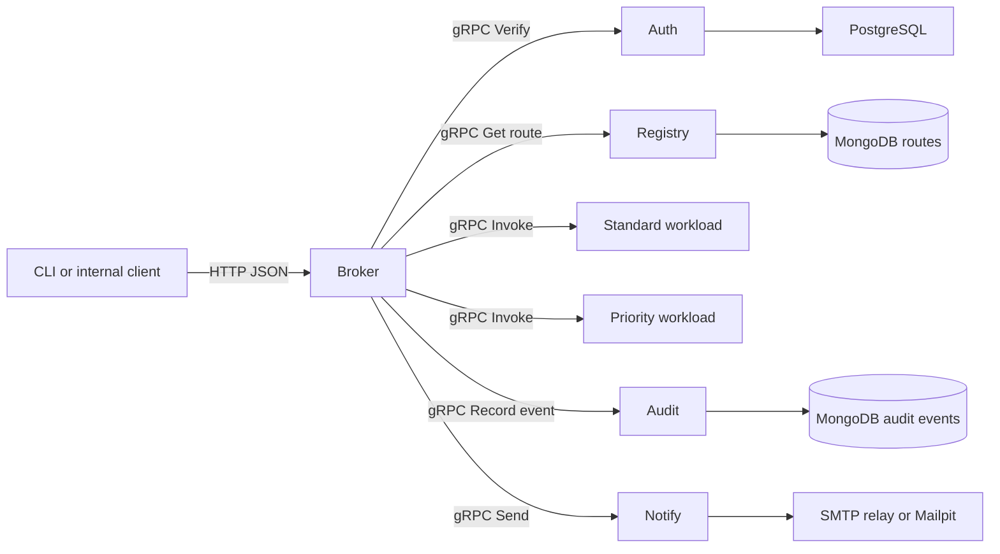

# Enterprise Service Governance Platform

A Go control plane for registering internal services, applying role-based access, and routing requests over gRPC. The demo runs two interchangeable workloads so a policy change is visible in the response.

## Run the demo

Install Docker with Compose v2, `make`, `curl`, `jq`, and OpenSSL. Run from the repository root.

```sh
make demo-up
make demo
make demo-down
```

`make demo-up` generates random local credentials in a gitignored `.env` file and builds the shared application image. The demo script creates a viewer and updates the `demo-echo` route. It checks unauthenticated and unauthorized requests, changes a routing rule live, verifies an email in the Mailpit inbox, and finds the invocation in MongoDB through the Audit API.

- Broker HTTP API at `http://127.0.0.1:8080`
- Mailpit inbox at `http://127.0.0.1:8025`
- Change host ports with `BROKER_PORT` and `MAILPIT_PORT`. Point the demo script at custom ports using `BASE_URL` and `MAILPIT_URL`.
- `make demo-down` stops the stack and keeps its database volumes. For a disposable demo reset, `docker compose down -v` deletes the local demo data.

## Architecture



| Component | Responsibility |
| --- | --- |
| Broker | Public JSON API, role enforcement, request ID, gRPC routing and error mapping |
| Auth | User creation, bcrypt password hashes, PostgreSQL-backed opaque sessions with one-hour expiry |
| Registry | Atomically replaces a logical service's default and ordered rule set in a MongoDB document |
| Audit | Persists metadata in MongoDB with a seven-day TTL index. Broker also emits JSON logs to stdout |
| Notify | Validates email input and sends through an SMTP relay. A successful response records relay acceptance |
| Workloads | Independent standard and priority echo processes that implement the same protobuf contract |

The application builds once and starts as a specific role. Compose and Helm run each role as its own workload. [Protobuf contract](api/governance/v1/governance.proto)

A routing rule matches when all nonempty fields match the authenticated role and the optional `X-Region` hint. The first match wins. When none match, the broker uses `default_backend`. Rules use deployment-configured aliases, which prevents clients from setting arbitrary network destinations. Region is a client-supplied routing hint. Authorization comes from the verified session's role.

### HTTP API

Use `Authorization: Bearer <token>` for protected endpoints. Request and response keys use snake case.

| Method and path | Role | JSON input or behavior |
| --- | --- | --- |
| `POST /v1/login` | Public | `email`, `password`. Returns `token`, `expires_unix`, and `identity` |
| `POST /v1/users` | Admin | `email`, `password`, `role` (`admin` or `viewer`) |
| `PUT /v1/routes/{service}` | Admin | `default_backend` and optional `rules` array. Replaces the entire route |
| `GET /v1/routes` | Admin or viewer | Lists up to 100 routes sorted by service name |
| `POST /v1/invoke/{service}` | Admin or viewer | `message` and optional `X-Region` header. Returns `backend`, `message`, and `request_id` |
| `POST /v1/notifications` | Admin | `to`, `subject`, `body`. Returns HTTP 204 after SMTP acceptance |
| `GET /v1/audit` | Admin | Returns up to 100 recent audit events |

```json
{
  "default_backend": "standard",
  "rules": [
    {"role": "viewer", "region": "us-east", "backend": "priority"}
  ]
}
```

Requests have a five-second deadline. Audit recording has a separate 750 ms budget. If audit storage is down, the broker logs the failed write and still returns the original business result. Audit events contain route templates and status metadata. Request bodies, credentials, and tokens stay out of the logs.

## Kubernetes demo

Install `kind`, `kubectl`, and Helm 3. Start Docker, then run these commands once.

```sh
bash scripts/init-demo.sh
docker compose build broker
kind create cluster --name governance --wait 180s
kind load docker-image governance:local --name governance
KUBE_CONTEXT=kind-governance scripts/k8s-demo.sh
```

Keep these two port forwards open in separate terminals.

```sh
kubectl --context kind-governance -n governance port-forward svc/governance-broker 18080:8080
```

```sh
kubectl --context kind-governance -n governance port-forward svc/governance-mailpit 18025:8025
```

```sh
BASE_URL=http://127.0.0.1:18080 MAILPIT_URL=http://127.0.0.1:18025 make demo
```

The chart runs two replicas per app role and one instance each of PostgreSQL, MongoDB, and Mailpit for the demo. App deployments use readiness probes, `maxUnavailable: 0`, `maxSurge: 1`, and a short pre-stop delay before graceful shutdown. Broker waits for its Auth and Registry channels to connect before becoming Ready. The internal gRPC client uses round-robin balancing over the Ready endpoints advertised by headless Services and can wait for a connection within each request's deadline. [Kubernetes rolling updates](https://kubernetes.io/docs/tasks/run-application/update-deployment-rolling/)

To test an actual rollout, load a second image tag and invoke the probe after the demo has created `demo-echo`.

```sh
docker tag governance:local governance:rollout-v2
kind load docker-image governance:rollout-v2 --name governance
KUBE_CONTEXT=kind-governance IMAGE_TAG=rollout-v2 scripts/rollout-probe.sh
```

The probe runs from inside the cluster through the Broker Service. It records each request's HTTP status in `rollout-results.csv` and fails if any observed request fails. The two tags can use the same application build to exercise Kubernetes replacement behavior. Delete the disposable cluster with `kind delete cluster --name governance`.

## CI and staging delivery

The [GitHub Actions workflow](.github/workflows/ci-cd.yml) runs race-enabled Go tests, vet, Helm lint, the Compose smoke test, and a kind rollout probe on pull requests and pushes to `main`. Passing builds on `main` publish a Linux/amd64 image to GHCR with the Git commit SHA. An optional staging job deploys the resulting image digest using Helm with `--atomic`. [GitHub Actions container publishing](https://docs.github.com/en/actions/tutorials/publish-packages/publish-docker-images)

To enable staging delivery, create a GitHub environment named `staging` and set the repository variable `ENABLE_STAGING_CD=true`. Set environment secret `KUBECONFIG_B64` to the base64 encoding of a kubeconfig for a namespace-scoped deployment identity reachable from the runner. Configure the environment variables below.

| Variable | Value |
| --- | --- |
| `STAGING_NAMESPACE` | Existing Kubernetes namespace, defaults to `governance` |
| `RPC_TLS_SECRET`, `RPC_TLS_SERVER_NAME` | Existing certificate Secret and its DNS SAN |
| `SMTP_ADDRESS`, `SMTP_FROM` | STARTTLS relay at `host:port` and sender email |
| `IMAGE_PULL_SECRET` | Existing image pull Secret if the GHCR package requires authentication |

Create `governance-secrets` in the staging namespace before the first deployment. It needs `INTERNAL_RPC_KEY` (at least 32 printable characters), `POSTGRES_DSN`, and `MONGO_URI`. Supply `BOOTSTRAP_EMAIL` and `BOOTSTRAP_PASSWORD` for the first install. An existing admin's password survives restarts. After creating the first admin, remove both bootstrap values and restart Auth to remove the seed credentials from the running containers. Supply `SMTP_USERNAME` and `SMTP_PASSWORD` if the relay requires authentication.

The TLS Secret contains `ca.crt`, `tls.crt`, and `tls.key`. Broker receives the CA certificate, while internal gRPC servers receive the leaf certificate and private key. The chart also supports separate role-specific Secrets using `authSecret`, `registrySecret`, `auditSecret`, and `notifySecret`. TLS for the external HTTP API terminates at the environment's ingress or proxy. Use database TLS, least-privilege service accounts, rate limiting at the ingress, and the network controls and backups required by your environment.

## Development and availability

```sh
make test
```

Generated Go stubs are checked in. To regenerate after editing the protobuf contract, install `protoc`, `protoc-gen-go@v1.36.12`, and `protoc-gen-go-grpc@v1.6.2` and run `make proto`. [gRPC Go quickstart](https://grpc.io/docs/languages/go/quickstart/)

99.9% is a proposed availability SLO. A rollout probe samples one release window. Sustained availability requires an observation period, a defined set of eligible requests, and measured success and latency. The demo databases each have one replica. SMTP sends synchronously and can be ambiguous if the connection breaks after the relay accepts a message.
